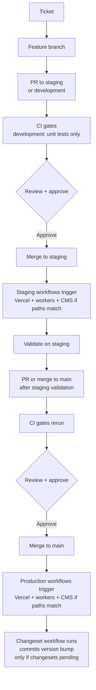
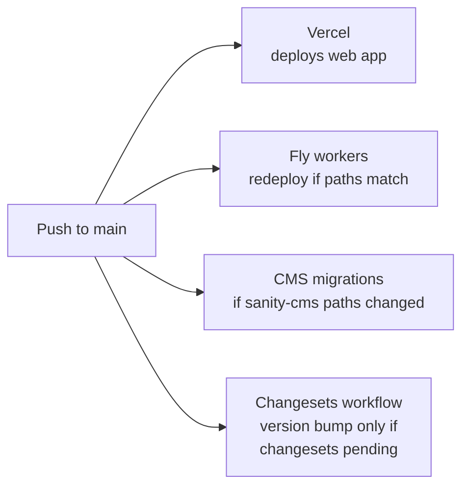

# Deployment workflow

How a change travels from a feature request to production. Every gate, every trigger, every branch.

This doc complements [vercel-web.md](./vercel-web.md) and [fly-io-workers.md](./fly-io-workers.md), which cover the per-component mechanics. Read this one first to understand the end-to-end flow.

## Branch model

Three long-lived branches in `Bulqit/bul-website`:

| Branch | Purpose | What pushes to it trigger |
|--------|---------|--------------------------|
| `main` | Production | Vercel prod deploy, affected Fly workers to prod, CMS migrations if Sanity paths changed, changeset workflow runs (commits a version bump only if pending changesets exist) |
| `staging` | Pre-production | Vercel `staging` custom environment deploy, affected Fly workers to staging, CMS migrations if Sanity paths changed |
| `development` | Shared integration branch for feature work | No GitHub Actions deploy workflows. Vercel builds a preview on push (stable alias `development.example.com`). PRs to `development` run unit tests only |

Current convention is conventional-commit-style prefixes: `feat/`, `fix/`, `hotfix/`, `chore/`, `bugfix/`, etc. This is the dominant pattern across recent branches (as of 2026-04-16, 30 of the 50 most recently-committed branches follow it).

Older branches often used `cu-<id>-<description>` or `CU-<id>_<description>`, matching ClickUp's task ID format. Historical branch names suggest FutureWorks used ClickUp ticket IDs for at least part of their workflow. The ClickUp pattern has mostly been abandoned (1 of the 50 most recent branches as of 2026-04-16). No automation links branches to any ticket system.

## Lifecycle of a feature



### Where `development` fits

`development` exists and appears in unit test triggers (`.github/workflows/unit-tests.yml`). It is an optional integration branch: teams can open feature branches against `development` for early collaboration before opening a PR to `staging`.

No GitHub Actions deploy workflows run from `development`. Vercel builds a preview on push to `development` with a stable alias `https://development.example.com`, which makes it a convenient target for validating work-in-progress before staging.

## PR gates

Every PR to `main` or `staging` runs the following checks. All must pass before merge (assuming GitHub branch protection is configured to require them).

| Workflow | File | Runs | Can fail PR? |
|----------|------|------|-------------|
| Lint | `lint.yml` | `pnpm turbo run lint` | Yes |
| Unit tests | `unit-tests.yml` | `pnpm turbo run test --filter='!e2e-cypress'` | Yes |
| Integration tests | `integration-tests.yml` | `pnpm turbo run test:integration` against a fresh local Postgres 15 | Yes |
| Cypress E2E | `e2e-cypress.yml` | Waits for the Vercel preview to reach `READY`, runs Cypress specs against the preview URL | Yes |
| Lighthouse | `lighthouse-ci.yml` | Picks the first Vercel deployment currently in `BUILDING`/`QUEUED`/`INITIALIZING`/`ANALYZING` state (does **not** filter by PR commit or branch), then runs Lighthouse on 5 pages (mobile + desktop) once it's READY. Posts scores as PR comment | Exits if no deployment is currently running. Exits success even if scores drop |

`unit-tests.yml` also runs on PRs to `development`. Lint, integration, Cypress, and Lighthouse only run against PRs to `main` or `staging`.

### Preview deploys

Vercel does **not** build a preview for every PR branch by default. The Vercel project has an Ignored Build Step that skips any branch other than `main`, `staging`, or `development`:

```
[ "$VERCEL_GIT_COMMIT_REF" = "main" ] || \
[ "$VERCEL_GIT_COMMIT_REF" = "staging" ] || \
[ "$VERCEL_GIT_COMMIT_REF" = "development" ] && exit 1 || exit 0
```

Vercel treats `exit 0` as "skip build" and non-zero as "continue build", so only `main`, `staging`, and `development` produce deploys.

Implication for PR gates. Cypress filters Vercel deployments by the PR's commit SHA and branch ref, so it needs the PR's preview to exist. Lighthouse does not filter by SHA or branch: it picks the first deployment currently in `BUILDING`/`QUEUED`/`INITIALIZING`/`ANALYZING` and runs against that URL, which may be a concurrent deploy on a different branch. For PRs from a feature branch, Vercel's Ignored Build Step skips the build entirely, so Cypress has nothing to match and Lighthouse has nothing currently running to pick. If you need a preview for a feature branch, push it to `development` first, or temporarily adjust the Ignored Build Step in Vercel project settings.

Preview URLs are behind Vercel Authentication; CI uses `VERCEL_AUTOMATION_BYPASS_SECRET` to access them.

## What happens on merge

A merge to `main` fans out to four independent pipelines. Vercel and the Changesets workflow run on every push to `main`; Fly worker deploys and CMS migrations are path-filtered. The Changesets workflow only commits a version bump if pending `.changeset/*.md` files produced a diff. They run in parallel and do not wait for each other.



A merge to `staging` fires the same fan-out minus the changeset bump, targeting staging Fly apps and the staging Sanity dataset.

Exactly which workflows fire depends on which files changed. Path filters gate each deploy workflow.

### Vercel (web app)

Vercel's GitHub integration deploys three branches and skips the rest:

| Branch | Deploy target | Aliases |
|--------|---------------|---------|
| `main` | Production | `https://www.bulqit.com`, `https://bulqit.com`, `https://main-preview.example.com` |
| `staging` | `staging` custom environment | `https://staging.example.com`, `https://staging.example.com` |
| `development` | Preview | `https://development.example.com`, `https://development-preview.example.com` |
| Any other branch | Skipped by Ignored Build Step | — |

There is no custom `staging.bulqit.com` domain. The staging environment is a Vercel custom environment with an empty domains array; access is via the Vercel aliases above.

Database migrations run as a Turbo build dependency (`bulqit-website#build` depends on `@bulqit/database#migrate` in `turbo.json`). Migrations execute during the Vercel build, before the web app builds.

### Fly.io workers

Each worker has its own deploy workflow, triggered only when the relevant paths change:

| Worker | Path filter | Production | Staging |
|--------|-------------|-----------|---------|
| Temporal | `apps/temporal-workers/**`, `packages/temporal-workflows/**`, `pnpm-lock.yaml` | Push to `main` | Push to `staging` |
| Zoho sync | `apps/worker-zoho-sync/**`, `packages/**`, `pnpm-lock.yaml` | Push to `main` | Push to `staging` |
| Notifications | `apps/worker-onboarding-notifications/**`, `packages/**`, `pnpm-lock.yaml` | Push to `main` | Push to `staging` |

Note: Zoho sync and notifications trigger on any change under `packages/**`. A change to an unrelated package will redeploy them.

The worker deploy jobs use GitHub Actions environments (`staging` or `production`). If GitHub Environments require reviewers, a worker deploy waits for that approval before it runs. The workflow files name the environments, but the approval rule itself lives in GitHub settings.

See [fly-io-workers.md](./fly-io-workers.md) for the deploy commands and verification.

### Sanity CMS migrations

`run-cms-migrations.yml` fires on push to `main` or `staging` when files under `packages/sanity-cms/migrations/**` or `packages/sanity-cms/src/schemas/**` change.

| Branch | Flow | Environment gate |
|--------|------|-----------------|
| `staging` | `migrate:status` → `migrate` → `migrate:status` against the `staging` Sanity dataset | `environment: staging` |
| `main` | `migrate:dry` (dry-run first) → `migrate:status` → `migrate` → `migrate:status` against the `production` Sanity dataset | `environment: production` |

The `environment: production` block uses GitHub's environment feature. If the repository's Environments settings require approval for `production`, the migration will wait for manual approval before running. The workflow file itself does not enforce approval; it's configured in GitHub > Settings > Environments.

Migrations run concurrently with the Vercel deploy. They are not gated against each other. If a CMS migration fails, the Vercel deploy still proceeds, and vice versa.

The `concurrency` block (`cancel-in-progress: false`) ensures a running migration is never cancelled mid-run.

### Changeset version bump

`changeset.yml` fires on every push to `main`. It runs `pnpm run changeset version`, which consumes any pending `.changeset/*.md` files, bumps package versions, and updates the changelog. The workflow then commits the result back to `main` as `github-actions[bot]` **only if the version command produced a diff**. If no changesets are pending, the workflow runs to completion without producing a commit.

To use this:
1. Run `pnpm changeset` locally to create a changeset file describing your change
2. Commit the changeset file with your PR
3. When the PR merges to `main`, the bot commits the version bump automatically

Publishing to a registry is not automated. `pnpm run release` exists but is manual. Package access is `restricted` in `.changeset/config.json`.

## Staging vs production

| Aspect | Staging | Production |
|--------|--------|-----------|
| Branch | `staging` | `main` |
| Vercel target | `staging` custom environment (Vercel aliases only, no custom domain) | Production (`bulqit.com`, `www.bulqit.com`) |
| Sanity dataset | `staging` | `production` |
| CMS migration safety | Direct apply | Dry-run first, then apply |
| CMS environment gate | `staging` | `production` (approval depends on GitHub env settings) |
| Fly apps | `-staging` suffix (e.g. `bul-temporal-workers-staging`) | Primary app names (e.g. `bul-temporal-workers`) |
| GitHub Actions env | `staging` for worker deploys and CMS migrations | `production` for worker deploys and CMS migrations; approval depends on GitHub env settings |

## Hotfixes

No formal hotfix process is documented in the repo. Based on the workflow triggers, the options are:

1. PR directly to `main` (bypasses staging validation)
2. PR to `staging`, validate, then PR to `main` (normal flow, slower)

Option 1 skips staging verification. Option 2 is the documented path. Which to use is a judgment call; check with the team before bypassing staging.

## Known gaps

Things that are worth knowing about before a surprise:

- **Post-merge validation is narrower than PR validation.** Cypress runs on PRs and on pushes to `main` or `staging`, but lint, unit, integration, and Lighthouse only run on PRs. Lighthouse also exits success even if scores drop.
- **Cypress and Lighthouse on PRs depend on a Vercel deployment that doesn't exist for feature branches.** Vercel's Ignored Build Step skips anything other than `main`, `staging`, or `development`, so a PR from a `feat/*` or `cu-*` branch has no deployment for these workflows to validate. Cypress will time out waiting for a matching deployment. Lighthouse will exit immediately if no deployment is currently running.
- **Lighthouse does not filter by PR commit or branch.** It picks the first deployment currently in `BUILDING`/`QUEUED`/`INITIALIZING`/`ANALYZING`, which may be a concurrent deploy on an unrelated branch. Reported scores may not reflect the PR under review.
- **CMS migrations and Vercel deploys are independent.** They do not wait for each other. A failed migration will not roll back a Vercel deploy.
- **Worker deploys trigger on broad `packages/**` changes.** Updating an unrelated package will redeploy notifications and Zoho sync workers.
- **`automated-build-and-testing.yml` is manual-only** (workflow dispatch). It runs a full Playwright suite against an ephemeral Neon branch. Useful for pre-release sanity checks but not automated into the PR flow.
- **No GitHub PR template or CODEOWNERS.** Review assignment is manual.
- **Branch protection rules are not in the repo.** They live in GitHub settings. If your PR isn't gated by the workflows above, the branch protection config is the place to check.

## File reference

The workflows live in `Bulqit/bul-website/.github/workflows/`:

- `lint.yml`, `unit-tests.yml`, `integration-tests.yml` — PR gates
- `e2e-cypress.yml` — PR and post-merge Cypress validation against the Vercel deployment
- `lighthouse-ci.yml` — PR-only Lighthouse report against the Vercel preview
- `automated-build-and-testing.yml` — manual full-pipeline run with Neon branch
- `run-cms-migrations.yml` — Sanity CMS migrations per branch
- `changeset.yml` — version bump on main
- `deploy-worker-temporal.yml`, `deploy-worker-temporal-staging.yml`
- `deploy-worker-zoho-sync.yml`, `deploy-worker-zoho-sync-staging.yml`
- `deploy-worker-onboarding-notifications.yml`, `deploy-worker-onboarding-notifications-staging.yml`
