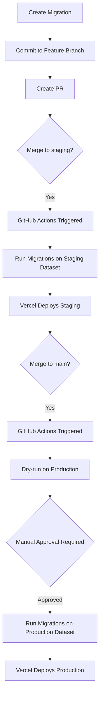

# Sanity CMS Migrations - CI/CD Guide

## Overview

This document explains how Sanity CMS content migrations are managed and automatically executed in our CI/CD pipeline.

## Architecture

### Sanity Datasets
We use separate Sanity datasets per environment:
- **`development`** - Local development (not used in CI/CD)
- **`staging`** - Staging environment (auto-deployed from `staging` branch)
- **`production`** - Production environment (auto-deployed from `main` branch)

### Migration System
- **Tool**: Sanity's built-in migration system
- **Location**: `packages/sanity-cms/migrations/`
- **Execution**: Automated via GitHub Actions on merge to `staging` or `main`

## How It Works

### Automatic Migration Flow



### Workflow Triggers

The migration workflow (`.github/workflows/run-cms-migrations.yml`) runs automatically when:

1. **Push to `staging` branch** with changes to:
   - `packages/sanity-cms/migrations/**`
   - `packages/sanity-cms/src/schemas/**`

2. **Push to `main` branch** with changes to:
   - `packages/sanity-cms/migrations/**`
   - `packages/sanity-cms/src/schemas/**`

3. **Manual trigger** via GitHub Actions UI (workflow_dispatch)

## Writing Migrations

### Migration File Structure

Create numbered migration files in `packages/sanity-cms/migrations/`:

```typescript
// packages/sanity-cms/migrations/001-your-migration-name.ts
import { defineMigration, at, setIfMissing, createIfNotExists } from 'sanity/migrate'

export default defineMigration({
  title: 'Clear description of what this migration does',

  migrate: {
    document(doc, context) {
      // Your migration logic here
      if (doc._type === 'yourDocumentType') {
        return [
          at('fieldName', setIfMissing('defaultValue'))
        ]
      }
      return []
    }
  }
})
```

### Best Practices

#### 1. Make Migrations Idempotent
Migrations may run multiple times. Always use safe operations:

```typescript
// ✅ GOOD - Won't overwrite existing data
at('field', setIfMissing('default'))

// ❌ BAD - Overwrites existing data
at('field', set('value'))
```

#### 2. Use Conditional Logic
Check document type and state before mutating:

```typescript
if (doc._type === 'myType' && !doc.newField) {
  return [at('newField', setIfMissing({ _type: 'reference', _ref: 'id' }))]
}
```

#### 3. Version Migrations
- Use numeric prefixes: `001-`, `002-`, `003-`
- Never modify existing migration files
- Always create new migrations for changes

#### 4. Document Your Migrations
```typescript
export default defineMigration({
  title: 'Add pricing allocation reference to homeowner dashboard',
  // Include comments explaining:
  // - What changes
  // - Why it's needed
  // - Any manual steps required
  migrate: {
    // ...
  }
})
```

## Testing Migrations Locally

### 1. Test on Development Dataset

```bash
# Dry-run (preview changes without applying)
NEXT_PUBLIC_SANITY_DATASET=development pnpm --filter @bulqit/sanity-cms migrate:dry

# Apply migration
NEXT_PUBLIC_SANITY_DATASET=development pnpm --filter @bulqit/sanity-cms migrate

# Check migration status
NEXT_PUBLIC_SANITY_DATASET=development pnpm --filter @bulqit/sanity-cms migrate:status
```

### 2. Verify in Sanity Studio

1. Open Sanity Studio: `http://localhost:3000/cms`
2. Check that content structure matches expectations
3. Verify existing content wasn't corrupted

### 3. Test Application Behavior

```bash
# Start dev server
pnpm dev

# Test affected pages/components
# Ensure no errors in console
```

## CI/CD Migration Process

### Staging Environment

When you merge to `staging`:

1. **Migration workflow triggers automatically**
2. Runs `migrate:status` to show current state
3. Executes migrations on `staging` dataset
4. Shows post-migration status
5. Vercel deployment proceeds (migrations complete first)

**No manual intervention required** ✅

### Production Environment

When you merge to `main`:

1. **Migration workflow triggers automatically**
2. Runs dry-run migration (preview only)
3. Shows migration status
4. **⏸️ Waits for manual approval** (if environment protection is configured)
5. After approval, executes migrations on `production` dataset
6. Shows post-migration status
7. Vercel deployment proceeds

**Manual approval required for safety** ⚠️

### Manual Trigger

You can also run migrations manually via GitHub Actions UI:

1. Go to **Actions** → **Run CMS Migrations**
2. Click **Run workflow**
3. Select environment: `staging` or `production`
4. Click **Run workflow**

## Monitoring Migrations

### GitHub Actions Logs

1. Go to **Actions** tab in GitHub
2. Find **Run CMS Migrations** workflow
3. Click on the run to see detailed logs
4. Check each step:
   - ✅ Migration status before
   - ✅ Migration execution
   - ✅ Migration status after

### Migration Status Command

Check applied migrations:

```bash
# Staging
NEXT_PUBLIC_SANITY_DATASET=staging pnpm --filter @bulqit/sanity-cms migrate:status

# Production
NEXT_PUBLIC_SANITY_DATASET=production pnpm --filter @bulqit/sanity-cms migrate:status
```

### Sanity Studio

Migrations are tracked in Sanity's system. Once applied, they won't re-run automatically.

## Rollback Strategy

### If Migration Fails

1. **Check the error** in GitHub Actions logs
2. **Review migration code** for issues
3. **Fix the migration** in a new PR
4. **Create a reverse migration** if needed:

```typescript
// packages/sanity-cms/migrations/002-revert-changes.ts
import { defineMigration, at, unset } from 'sanity/migrate'

export default defineMigration({
  title: 'Revert: previous migration description',

  migrate: {
    document(doc, context) {
      if (doc._type === 'affectedType') {
        return [
          at('fieldThatWasAdded', unset())
        ]
      }
      return []
    }
  }
})
```

### Emergency Rollback

If migrations cause production issues:

1. **Revert the merge** to `main` branch
2. **Deploy previous version** (triggers Vercel rollback)
3. **Create and run reverse migration** to fix CMS state
4. **Fix the migration** in a new PR
5. **Test thoroughly** on staging before re-deploying

## Environment Configuration

### Required GitHub Secrets

- `SANITY_AUTH_TOKEN` - Sanity authentication token with write permissions for running migrations (required for CI/CD)

### Required GitHub Variables

- `NEXT_PUBLIC_SANITY_PROJECT_ID` - Sanity project ID (already configured)
- `NEXT_PUBLIC_SANITY_API_VERSION` - API version (already configured)

### Dataset Configuration

Datasets are environment-specific:
- Staging uses `NEXT_PUBLIC_SANITY_DATASET=staging`
- Production uses `NEXT_PUBLIC_SANITY_DATASET=production`

These are hardcoded in the workflow for safety.

## GitHub Environment Protection (Recommended)

To require manual approval for production migrations:

1. Go to **Settings** → **Environments**
2. Create **production** environment (if not exists)
3. Enable **Required reviewers**
4. Add team leads as reviewers
5. Optionally add **Wait timer** (e.g., 5 minutes)

This ensures production migrations are reviewed before running.

## Common Migration Patterns

### Adding a New Field

```typescript
export default defineMigration({
  title: 'Add subtitle field to blog posts',
  migrate: {
    document(doc) {
      if (doc._type === 'blogPost') {
        return [at('subtitle', setIfMissing(''))]
      }
      return []
    }
  }
})
```

### Creating a Singleton Document

```typescript
export default defineMigration({
  title: 'Create default settings document',
  migrate: {
    document(doc) {
      if (doc._type === 'siteSettings' && doc._id === 'siteSettings') {
        return createIfNotExists({
          _id: 'siteSettings',
          _type: 'siteSettings',
          siteName: 'My Site',
          description: 'Default description'
        })
      }
      return []
    }
  }
})
```

### Adding a Reference

```typescript
export default defineMigration({
  title: 'Link posts to default category',
  migrate: {
    document(doc) {
      if (doc._type === 'post' && !doc.category) {
        return [
          at('category', setIfMissing({
            _type: 'reference',
            _ref: 'default-category-id'
          }))
        ]
      }
      return []
    }
  }
})
```

### Uploading Assets During Migration

```typescript
import { defineMigration, at, setIfMissing } from 'sanity/migrate'
import path from 'path'
import fs from 'fs'

export default defineMigration({
  title: 'Add default images to steps',
  migrate: {
    async document(doc, context) {
      if (doc._type === 'steps') {
        const imagePath = path.join(__dirname, 'assets/images/step-1.png')
        const imageBuffer = fs.readFileSync(imagePath)

        const asset = await context.client.assets.upload('image', imageBuffer, {
          filename: 'step-1.png'
        })

        return [
          at('image', setIfMissing({
            _type: 'image',
            asset: { _type: 'reference', _ref: asset._id }
          }))
        ]
      }
      return []
    }
  }
})
```

## Troubleshooting

### Migration Workflow Doesn't Trigger

- ✅ Check if changes were made to `migrations/` or `schemas/` folders
- ✅ Verify branch name is exactly `staging` or `main`
- ✅ Check GitHub Actions is enabled for the repository

### Migration Fails with "Permission Denied"

- ✅ Verify `SANITY_AUTH_TOKEN` secret is configured in GitHub
- ✅ Check token has write permissions (robot or personal token)
- ✅ Ensure token is valid and not expired
- ✅ Verify token has access to the correct dataset

### Migration Runs But Doesn't Apply Changes

- ✅ Check migration is exported from `migrations/index.ts`
- ✅ Verify migration logic is correct (use dry-run to test)
- ✅ Ensure migration is idempotent and checks existing state

### "Migration Already Applied" Error

- ✅ This is normal - Sanity tracks applied migrations
- ✅ Create a new migration file if you need to make changes
- ✅ Never modify existing migration files

## Resources

- [Sanity Migrations Documentation](https://www.sanity.io/docs/content-migrations)
- [Migration API Reference](https://www.sanity.io/docs/migrate-api)
- [Migration Examples](https://github.com/sanity-io/sanity/tree/next/examples/migrations)

## Support

For issues or questions:
1. Check this documentation
2. Review GitHub Actions logs
3. Check Sanity Studio for migration status
4. Contact the development team
