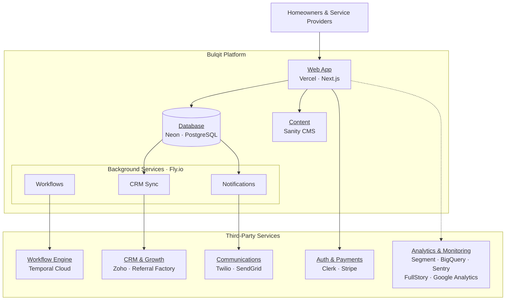
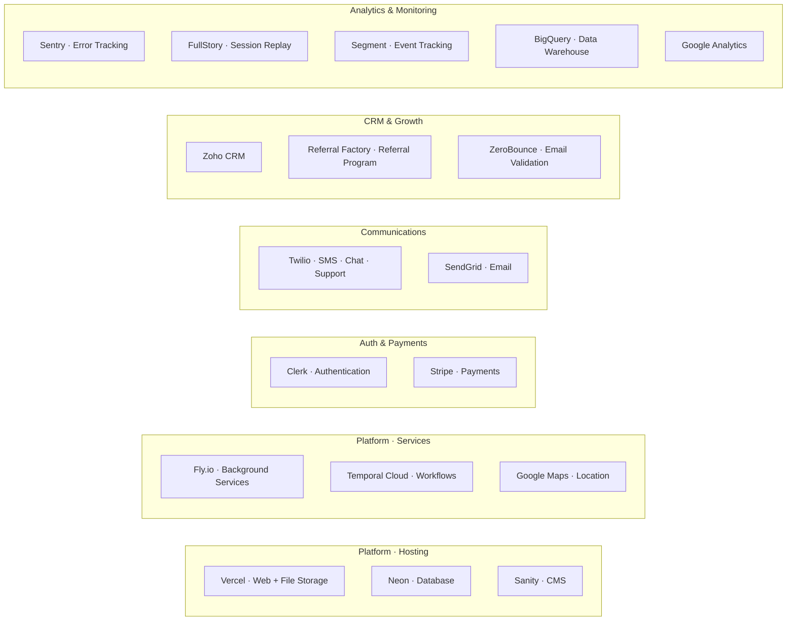
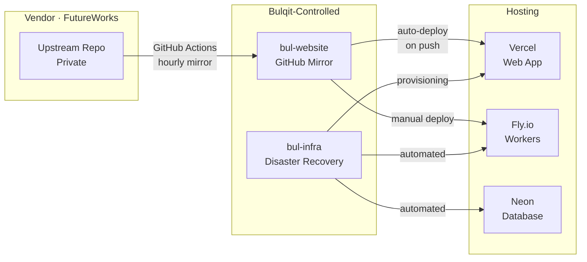

# Bulqit Infrastructure Overview

## Production Architecture

## Service Inventory

**Service inventory notes:**

- **BigQuery** is a Segment destination, not a direct code integration. Whether data flows there depends on Segment dashboard configuration.

## Deployment Model

## Reconstruction Flow

```mermaid
graph TD
    subgraph onetime["One-Time Setup"]
        O0["Configure credentials<br/>Install CLI tools"]
        O1["<u>mise setup</u><br/>Authenticate all CLIs"]
        O2["<u>mise init</u><br/>Initialize Terraform<br/>Bootstrap env files"]
        O0 --> O1 --> O2
    end

    START(["mise reconstruct"])

    subgraph preflight["Pre-flight Checks"]
        PF1["Env files exist?"]
        PF2["Production guards OK?"]
    end

    subgraph auto["Interactive · 11 Steps"]
        S1["1 · Clone mirror repo"]
        S2["2 · Provision Vercel project + domain"]
        S3["3 · Link workspace to Vercel"]
        S4["4 · Install Neon integration"]
        S5["5 · Push Vercel env vars"]
        S6["6 · Deploy web app"]
        S7["7 · Create Fly.io org"]
        S8["8 · Provision Fly workers"]
        S9["9 · Push Fly secrets"]
        S10["10 · Deploy workers"]
        S11["11 · Health checks"]
    end

    subgraph manual["Manual Steps"]
        M1["Restore database backup"]
        M2["Import Sanity CMS dataset"]
        M3["Configure Clerk,<br/>Temporal, SendGrid"]
        M4["Re-enable GitHub Actions"]
        M5["Redeploy with updated config"]
        M6["DNS cutover"]
    end

    O2 --> START
    START --> PF1 --> PF2
    PF2 --> S1 --> S2 --> S3 --> S4 --> S5 --> S6
    S6 --> S7 --> S8 --> S9 --> S10 --> S11
    S11 --> M1 --> M2 --> M3 --> M4 --> M5 --> M6

    style onetime fill:#e3f2fd,stroke:#1976d2
    style preflight fill:#f0f0f0,stroke:#999
    style auto fill:#e8f5e9,stroke:#4caf50
    style manual fill:#fff3e0,stroke:#ff9800
```

